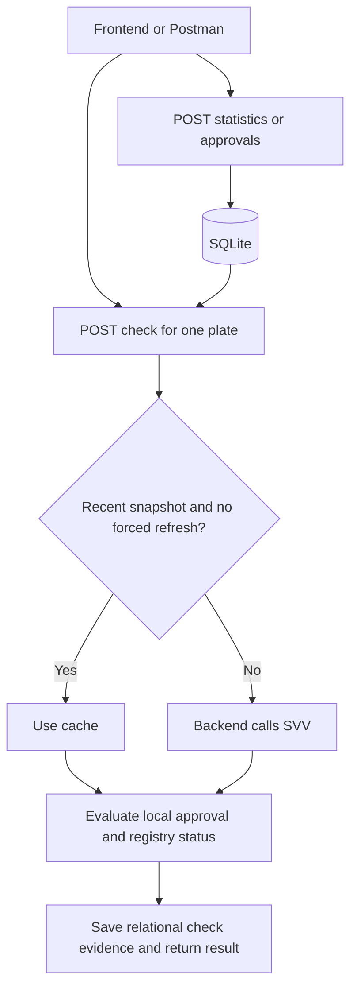

# Vehicle backend guide

This Kotlin/Ktor service accepts JSON containing vehicle statistics and approvals, stores them in SQLite, and checks one registration number against local approval data and Statens vegvesen (SVV).

A statistics row covers a mandatory reporting period and may represent several jobs or days, not one individual trip. Approval is separate: submitting statistics never approves a vehicle. All examples here are synthetic. Agents must not inspect confidential datasets, real vehicle responses, or logs containing them.

## Request flow

1. Submit usage statistics through `POST /api/trip-rows`.
2. Submit approved vehicles through `POST /api/vehicle-approvals`.
3. Check one plate through `POST /api/vehicle-checks`.
4. The backend reads local approval/statistics, reuses a recent snapshot or calls SVV, then saves and returns a combined result.

There are no import IDs to pair or suppliers to select. The API accepts JSON, not PDF/spreadsheet uploads. Convert source columns into the fields below before submitting.



## Run and configure

Use JDK 21 and the checked-in Gradle wrapper. Docker/Rancher Desktop is optional. An SVV Enkeltoppslag key is required only for live requests.

Configure root `.env` once using [the shared setup](../README.md#shared-local-configuration). Fill its required JWT secret and seed passwords privately, optionally adding the SVV key. Then from `backend/` in PowerShell:

```powershell
.\gradlew.bat test
.\gradlew.bat run
```

Tests do not start a persistent Postman server. They use throwaway credentials, an isolated database and `BACKEND_ENV_FILE` pointing to an absent test-only file, with live SVV disabled; they never load root `.env`. Keep the run terminal open; stop with `Ctrl+C`.

Configuration regression checks are available from the repository root:

```powershell
.\scripts\tests\Migrate-LocalEnv.Tests.ps1
# Build the distribution first; this does not start your normal database.
.\backend\gradlew.bat -p backend installDist
.\scripts\tests\Backend-RootEnv.Smoke.ps1
```

The migration tests use a synthetic temporary directory. The startup smoke uses a fake checkout and synthetic `.env` under ignored `backend/build/test-data/`, launches Java hidden on an available loopback port, verifies auth cookies/CORS/isolated SQLite/disabled SVV, and stops that test server. It never opens the development database or makes an SVV request. Synthetic test artifacts remain available locally for troubleshooting.

| Setting | Default | Where to set | Meaning |
|---|---|---|---|
| `SVV_API_KEY` | Unset | Process environment or root `.env` | Private key enabling live SVV requests |
| `SVV_CACHE_TTL_DAYS` | `14` | Process environment or root `.env` | Positive whole days a successful snapshot may be reused |
| `VEHICLE_DB_PATH` | `data/vehicles.db` | Process environment or root `.env` | SQLite path; relative paths use the server working directory; Compose uses its own volume path |
| `HOST` | `127.0.0.1` | Process environment or root `.env` | Standalone listening interface; container default is `0.0.0.0` |
| `PORT` | `8080` | Process environment or root `.env` | Standalone HTTP port; Compose fixes container port at 8080 |
| `CORS_ALLOWED_ORIGINS` | `http://localhost:5173` | Process environment or root `.env` | Comma-separated full frontend origins; root template includes Vite 5173 and Docker 3000; include schemes and omit paths |

All application settings, including authentication, cookies, CORS, proxy hops and optional `TESSERACT_PATH`, use the same root `.env`. Launching from the repository root or `backend/` finds that file; retired `backend/.env` is not read. Explicit process values take precedence, **including blank values**: a blank `SVV_API_KEY` disables live calls, and blank required secrets fail startup. Remove a PowerShell override with e.g. `Remove-Item Env:SVV_API_KEY` to return to the saved value. Invalid, zero, negative, or oversized TTL values fall back to 14. Restart after configuration changes.

Use single-line literal values. Unquoted values trim whitespace and allow whitespace followed by an inline `#` comment. Single quotes preserve `$`, `#` and backslashes literally; double quotes support common backslash escapes. The standalone loader deliberately does not perform variable expansion, shell execution, multiline values or `export` directives. Use the common literal subset shown by root `.env.example` rather than Compose/Vite-specific syntax. Keep each key unique.

Advanced: `BACKEND_ENV_FILE` can be supplied in the process environment to select a different file (relative to the server working directory or absolute). Tests use this to avoid local configuration. Packaged deployments without checkout markers fall back to working-directory `.env`; normally inject process settings instead and do not bundle a file. Relative database paths always use the working directory, not the configuration-file directory.

Example optional values in root `.env` (the required authentication fields must also be filled):

```dotenv
SVV_API_KEY=your-private-key-here
SVV_CACHE_TTL_DAYS=14
```

For isolated manual testing:

```powershell
$env:VEHICLE_DB_PATH = "data/manual-test.db"
$env:CORS_ALLOWED_ORIGINS = "http://localhost:5173"
.\gradlew.bat run
```

These settings apply to that PowerShell session and its child processes. Postman environment variables configure requests, not the backend process.

The key must never be sent to our API, exposed through a `VITE_` variable, or committed. Root `.env` and migration backups are ignored by Git; the root file is outside both Docker build contexts. Root `.env.example` contains no secret. Vite exposes public `VITE_` fields only, not backend credentials.

JWT authentication is available for the auth routes documented below. Vehicle routes are still unauthenticated and have no role/supplier access restrictions. CORS does not provide authorization. The standalone default host and Compose's published backend port are bound to loopback for local development. Local processes can still access these endpoints; authentication and authorization must be implemented before deployment or exposure to other machines.

### Docker

From `backend/`:

```powershell
docker build -t ktor-backend .
docker run --env-file ../.env -e HOST=0.0.0.0 -e PORT=8080 -e VEHICLE_DB_PATH=/app/data/vehicles.db -p 127.0.0.1:8080:8080 -v vehicle-backend-data:/app/data ktor-backend
```

The key and required authentication settings are supplied at runtime from root `.env`. Docker's raw `--env-file` parser differs from Compose's dotenv parser: use simple unquoted values for this standalone command; prefer Compose for the documented quoted literal values. The named volume preserves SQLite across container replacement. The image initializes a new data volume for the unprivileged `app` user. Existing volumes created by an older root-running image may need an ownership migration before startup; do not delete stored vehicle data. Compose keeps the root filesystem read-only, with only the data volume and JVM scratch directory writable, and retains its capability and privilege restrictions. This command publishes only on the host loopback interface.

For the full stack, use the [root README](../README.md#run-the-full-stack-with-docker). Compose reads the same root `.env`, requires JWT/seed-password settings, passes selected backend settings, and mounts persistent vehicle storage. Public frontend build arguments are passed separately; no backend secrets enter the frontend build. Standalone auth settings also load from root `.env` automatically. The existing malformed Gradle command in `backend/Dockerfile` remains a separate build blocker; see the root guide before trying a full image build.

## Admin vehicle-page read API

The admin frontend draft uses real vehicle endpoints even if login mocks are enabled separately. These GET requests only read SQLite: they never create vehicles, save checks or call SVV.

| Endpoint | Parameters / result |
|---|---|
| `GET /api/vehicles` | `search`: optional partial registration number, case/space/hyphen normalized, up to 7 letters/digits. `approvalStatus`: optional `ACTIVE`, `NOT_YET_ACTIVE`, `EXPIRED`, `REVOKED`, or `NOT_APPROVED`. `page`: positive integer, default 1. `pageSize`: 1–100, default 25. Returns `items`, `total`, `page`, `pageSize`, and `approvalAsOf`. Stable registration-number order. |
| `GET /api/vehicles/{registrationNumber}` | Returns current vehicle/approval, `approvalStatus`, `approvalAsOf`, all stored reporting rows newest first, latest selected SVV snapshot and latest saved check summary. Unknown plate: 404, without inserting it. |
| `GET /api/vehicles/{registrationNumber}/checks` | `page`: positive integer, default 1. `pageSize`: 1–100, default 10. Returns newest-first saved check summaries with `items`, `total`, `page`, and `pageSize`. Unknown vehicle: 404; known vehicle with no checks: empty items. |

Malformed parameters return 400. Out-of-range pages return empty items, not an error. Approval is evaluated on the current Oslo date (including the expiry date). Each read uses a single SQLite read transaction; its totals and items share one database snapshot. The summary's approval and deviations describe the **time of that check**, whereas the overview/details approval describes **today**. `dataSource` likewise describes how SVV data was obtained when that check ran; use `checkedAt` and `fetchedAt` to judge age.

Use the existing `GET /api/vehicle-checks/{id}` for original check evidence. Opening the frontend or selecting history does not create checks. Only the explicit Run check action posts `/api/vehicle-checks`; `forceRefresh` remains optional. The details API currently returns all reporting rows for one vehicle; paginated statistics and batch actions are deferred. List/history paging bounds database work, but pagination is not a cross-request frozen snapshot if records change between pages.

These routes retain the existing unauthenticated vehicle-route policy. The frontend's admin route guard is not server-side authorization; do not expose the draft beyond local development until backend access controls are implemented.

## Authentication

Vehicle records use SQLite, but the separate authentication user store is currently in memory. These demo accounts are seeded at startup:

| Email                          | Role     | Password env var         |
| ------------------------------- | -------- | ------------------------- |
| `advisor.hansen@kommune.no`     | ADMIN    | `SEED_ADMIN_PASSWORD`     |
| `supplier@nordvik.no`           | SUPPLIER | `SEED_SUPPLIER_PASSWORD`  |

Both seed password env vars are required: the backend refuses to start if
either is missing or blank.

Endpoints (all under `/api/auth`):

- `POST /login` — `{ email, password, rememberMe }` → `{ expiresAt, user }`, and sets the
  `auth_token` cookie (HttpOnly, SameSite=Strict, Secure, path `/api`). With `rememberMe` the
  cookie lasts 30 days; otherwise it is a session cookie.
- `POST /logout` — clears the `auth_token` cookie
- `GET /me` — requires the `auth_token` cookie, returns the current user
- `POST /forgot-password` — `{ email }`, always responds `200` (no account enumeration)
- `POST /reset-password` — `{ token, newPassword }`, token is single-use and valid for 15 minutes;
  a successful reset invalidates every JWT previously issued to that user

There is no email delivery yet. To test the reset flow locally, set
`APP_ENV=dev` and `ALLOW_DEV_PASSWORD_RESET_LOG=true`, and the reset
token is written to the backend log. Anyone who can read the logs can take over
any account, so the backend refuses to start with this flag unless
`APP_ENV=dev`.

The JWT is only ever sent as that HttpOnly cookie, so page scripts can't read it;
`Authorization` headers are ignored. Because the cookie is `SameSite=Strict`, the
frontend and the API must be served from the same site (e.g. `localhost:3000` and
`localhost:8080`, or `app.example.no` and `api.example.no`). Requests from origins
not in `CORS_ALLOWED_ORIGINS` are rejected with `403`.

`/login`, `/forgot-password`, and `/reset-password` are rate-limited to 10 requests/minute per
client IP. Behind a load balancer or ingress, set `TRUSTED_PROXY_HOPS` so the
limit applies per real client instead of to everyone at once.

On top of that, each account is locked after 5 consecutive failed logins: first
for 30 seconds, doubling with every further failure up to 15 minutes. While
locked, `/login` answers `429` with a `Retry-After` header without checking the
password. The lock is keyed on the submitted email, so unknown emails behave the
same and it can't be used to discover accounts. A successful login or password
reset clears it. Failures older than an hour are forgotten.

New passwords (via `/reset-password`) must be 12–72 bytes long; there are no
character-class rules, following NIST SP 800-63B.

Relevant environment variables:

| Variable                 | Default                                 | Purpose                                   |
| ------------------------- | --------------------------------------- | ------------------------------------------ |
| `JWT_SECRET`               | none — required, startup fails if unset | Signs and verifies JWTs                   |
| `JWT_ISSUER`                | `tdt4290-backend`                       | JWT `iss` claim                           |
| `JWT_AUDIENCE`              | `tdt4290-frontend`                      | JWT `aud` claim                           |
| `SEED_ADMIN_PASSWORD`       | none — required, startup fails if unset | Password for the seeded admin account     |
| `SEED_SUPPLIER_PASSWORD`    | none — required, startup fails if unset | Password for the seeded supplier account  |
| `APP_ENV`                   | `prod`                                  | `dev` or `prod`; dev-only features refuse to start in `prod` |
| `ALLOW_DEV_PASSWORD_RESET_LOG` | `false`                            | Log password reset tokens; requires `APP_ENV=dev` |
| `AUTH_COOKIE_SECURE`        | `true`                                  | Set `false` only if a local browser drops Secure cookies on `http://localhost` (Safari) |
| `TRUSTED_PROXY_HOPS`        | `0`                                     | Number of proxies in front of the backend; client IPs for rate limiting are then read from `X-Forwarded-For`. Keep `0` if clients connect directly, or the header can be spoofed |
| `CORS_ALLOWED_ORIGINS`      | `http://localhost:5173`                 | Comma-separated full origins (`scheme://host[:port]`) allowed to call the API. Each allows only its own scheme; use `https://` outside local dev |

User IDs are regenerated on restart, so old JWTs stop identifying these users after a backend restart. The seeded supplier identifier is not automatically linked to the vehicle database's supplier table. Public user fields are `id`, `name`, `email`, `role`, and optional `supplierId`; password hashes are not returned. Tokens expire after one day, or 30 days with `rememberMe: true`.

Handled auth credential errors use `{"message":"..."}`, whereas handled vehicle errors use `{"error":"..."}`. Auth bodies use Ktor request decoding; the vehicle-specific validation/error rules below should not be assumed for auth decoding failures.

Postman login example (set a local `adminPassword` variable matching the backend process setting):

```json
{
  "email": "advisor.hansen@kommune.no",
  "password": "{{adminPassword}}",
  "rememberMe": false
}
```

Postman's cookie jar retains the `auth_token` cookie from login and sends it to `/api/auth/me`; logout clears it. Do not configure a Bearer token: Authorization headers are ignored. Vehicle tests continue to use No Auth. Do not share credentials or tokens with agents.

## Shared request rules

Vehicle POST bodies use Content-Type: application/json. There are no query parameters; vehicle routes currently require no Authorization header.

- Unknown fields are rejected, including additionalFields, legacy aliases, and user-supplied estimatedCo2Kg.
- Text must be quoted JSON text. Booleans must be unquoted true/false. Amounts must be JSON numbers, not quoted strings. tripCount is a non-negative 32-bit integer.
- Required fields cannot be missing or null. Optional fields may be omitted/null. Missing is not zero or false.
- Amounts are non-negative exact decimals: at most 18 fractional places after removing insignificant trailing zeroes, and an unscaled integer between 0 and 9223372036854775807. Unsupported values are rejected, never rounded.
- Plates are uppercased, with whitespace/hyphens removed, then must match `^[A-Z]{2}[1-9][0-9]{3,4}$`: two letters followed by four or five digits, no leading zero. This accepts ordinary Norwegian plates only, not personal/historical/foreign formats, and validates syntax rather than registry recognition. Directory search remains partial.
- Trip rows require periodStart and periodEnd: valid YYYY-MM-DD dates with start <= end. Both boundaries are inclusive. Single-day periods are allowed.
- Batches contain 1–10,000 entries. One invalid entry rejects the entire batch. BEGIN IMMEDIATE reserves SQLite's writer before reading, waits up to five seconds for contention, and rolls back failed writes atomically.
- The normalized registration number is the vehicle primary key. Other record IDs are UUID strings. Generated timestamps are UTC with nine fractional digits. Approval is evaluated as of today in Europe/Oslo, not the statistics period.
- Optional/default response fields can be omitted. estimatedCo2Kg is always returned on stored statistics rows as a number calculated from required supplier inputs.
- fuelTechnology always means fuel technology, but belongs to a separate supplier, approval or registry observation. Approvals and trip rows now require official code strings, not labels or broad values such as Fossil or Electric/Hydrogen. Never guess a more specific value during import.

### Classification codes and English labels

Fuel/category/body-type dropdowns display official codes alongside application-owned English labels. API inputs store the codes as JSON strings, not numbers or translated labels. Kotlin enums, TypeScript literal unions and SQLite CHECK constraints restrict submitted values. The frontend catalogue parity test ensures both clients stay aligned.

| fuelTechnology | English label | fuelTechnology | English label |
|---|---|---|---|
| `"1"` | Gasoline | `"2"` | Diesel |
| `"3"` | Kerosene | `"4"` | Gas |
| `"5"` | Electric | `"6"` | Hydrogen |
| `"7"` | Gasoline hybrid | `"8"` | Diesel hybrid |
| `"9"` | Other fuel | `"10"` | Biodiesel |
| `"11"` | Biogasoline | `"12"` | LPG |
| `"13"` | CNG | `"14"` | Methanol |
| `"15"` | Ethanol | `"16"` | LPG A |
| `"17"` | LPG B | `"18"` | CNG 20 |
| `"19"` | CNG 25 | `"20"` | Compressed air |
| `"21"` | LNG | `"22"` | CNG and LNG |

These are the complete [SVV fuel codes](https://autosys-kjoretoy-api.atlas.vegvesen.no/kodeverk-ui/index-kodeverk.html?kodeverkId=DRIVSTOFFTYPE). Gasoline hybrid and diesel hybrid remain separate; no separate hybridCategory or isHybrid field is accepted or retained. The fuel codes do not establish whether a hybrid is plug-in/non-plug-in or which fuel was actually used during a period.

`vehicleCategory` replaces approval `vehicleGroup` and is also required on trip rows. Submitted categories are `M1`, `M1G`, `M2`, `M2G`, `M3`, `M3G`, `N1`, `N1G`, `N2`, `N2G`, `N3`, `N3G`, `O1`, `O2`, `O3`, `O4`: passenger cars, buses, vans, trucks, their off-road variants and trailers. This is not the former approval sheet's 7.5-tonne grouping. See [SVV technical categories](https://autosys-kjoretoy-api.atlas.vegvesen.no/kodeverk-ui/index-kodeverk.html?kodeverkId=TEKNISKKODE) and `VehicleCatalog.kt` / `vehicleCatalog.ts` for the code/English-label definitions.

`bodyType` replaces ambiguous trip-row `vehicleType` and represents body style, not technical category: e.g. `AA` Sedan, `AB` Hatchback, `AC` Station wagon, `AD` Coupe, `AE` Convertible. The complete [SVV body-type catalogue](https://autosys-kjoretoy-api.atlas.vegvesen.no/kodeverk-ui/index-kodeverk.html?kodeverkId=KAROSSERITYPE) is supported, including bus/truck/trailer bodies. Do not automatically reinterpret an old spreadsheet's Biltype text as a code without verifying its meaning. Body type is not an approval requirement in this version.

Unpowered trailers (`O1`–`O4`) must use `fuelTechnology: "NOT_APPLICABLE"`. This is an **application-only sentinel**, not an official SVV code and not the same as Other fuel (`"9"`). It is invalid for non-trailer categories. No engine-powered trailer exception is represented in this version. Both litres fields must be omitted/null for electric (`"5"`), hydrogen (`"6"`) and unpowered trailers. They are required for other submitted fuels, including both hybrids. The API has no kg/kWh/m³ consumption inputs; do not convert those quantities into litres by relabelling them.

## Routes and HTTP statuses

| Method and route | Purpose | Success |
|---|---|---|
| GET /health | Liveness: {"status":"UP"} | 200 |
| GET / | Text greeting | 200 |
| POST /api/trip-rows | Append reporting-period statistics | 201 |
| POST /api/vehicle-approvals | Add/replace submitted approvals | 201 |
| POST /api/vehicle-approvals/{registrationNumber}/revoke | Revoke one approval | 200 |
| POST /api/vehicle-checks | Save a check for one plate | 201 |
| GET /api/vehicle-checks/{id} | Retrieve original saved evidence | 200 |

Malformed JSON, unknown fields, wrong types and invalid values return 400 with an error object. Missing saved checks/unrevoked approvals return 404. SQLite contention returns 503 with {"error":"Vehicle database is busy; try again later"}. Other unhandled errors return 500 with "Internal server error".

An SVV failure does not prevent saving a check: POST still returns 201. Inspect registry lookup metadata, not just HTTP status. Health does not verify SVV configuration/connectivity.

## Append statistics

POST /api/trip-rows, Body → raw → JSON:

~~~json
{
  "sourceName": "synthetic-trip-sheet",
  "rows": [
    {
      "registrationNumber": "AB 12345",
      "periodStart": "2026-01-01",
      "periodEnd": "2026-01-31",
      "fuelTechnology": "2",
      "vehicleCategory": "M1",
      "bodyType": "AC",
      "make": "Synthetic Make",
      "model": "Synthetic Model",
      "co2Registered": true,
      "co2GramsPerKm": 123.456,
      "medianCo2": 120.25,
      "totalTripKm": 1000,
      "totalKmCo2Registered": 1000,
      "totalKmCo2NotRegistered": 0,
      "kmFuelNotRegistered": 0,
      "totalKmFuelRegistered": 1000,
      "totalKmNoxRegistered": 1000,
      "totalNoxRegisteredGrams": 25.67,
      "averageConsumptionLitresPerKm": 0.08,
      "fuelConsumedLitres": 80,
      "tripCount": 3
    }
  ]
}
~~~

| Field | JSON type | Meaning |
|---|---|---|
| registrationNumber | Required string | Regnr / Registreringsnr. |
| periodStart, periodEnd | Required date strings | Reporting-period boundaries; not individual journey dates |
| fuelTechnology | Required code string | Supplier-reported fuel; official code, or trailer-only NOT_APPLICABLE |
| vehicleCategory | Required code string | Supplier-reported SVV technical category |
| bodyType | Required code string | Supplier-reported body style; distinct from technical category |
| make, model | Required non-blank strings | Supplier make/model |
| co2Registered | Required boolean | Supplier marks the vehicle as CO₂-emitting; false must be explicit |
| co2GramsPerKm | Required number | Supplier emission rate, g/km |
| medianCo2 | Required number | Stored source value; meaning/unit are not inferred |
| totalTripKm | Required number | Unified distance, km; includes former km per buss |
| totalKmCo2Registered, totalKmCo2NotRegistered | Required numbers | Supplier CO₂ coverage distances, km |
| kmFuelNotRegistered, totalKmFuelRegistered | Required numbers | Supplier fuel-data coverage distances, km |
| totalKmNoxRegistered | Required number | Distance covered by reported NOx mass, km |
| totalNoxRegisteredGrams | Required number | Supplier NOx mass over that distance, grams; zero is accepted |
| tripCount | Required integer | Job/trip count; zero is accepted |
| assignmentNumber | Optional string | Oppdrag nr. |
| averageConsumptionLitresPerKm | Conditionally required number | Average consumption, L/km; not L/100 km. Must be omitted/null for codes 5, 6 or NOT_APPLICABLE |
| fuelConsumedLitres | Conditionally required number | Total litres; same applicability rule as average consumption |
| comment | Optional string | Supplier comment |

All statistics fields above are mandatory except comments/references and inapplicable litres. sourceName is an optional batch reference, not an import ID or supplier identifier; assignmentNumber is an optional job reference. Trip rows have no approval flag. Zero and false are valid explicit values; missing measurements are not replaced with zero, inferred from SVV or defaulted by the UI. If a supplier cannot provide a required value, the current strict contract does not accept the row.

Response: createdAt, rowCount, distinctVehicleCount, rows. Stored rows contain id, registrationNumber, optional sourceName, createdAt, data and read-only estimatedCo2Kg. Stored plates are normalized. Repeated submissions append more rows, including identical/overlapping periods. No deduplication or summation occurs. Retrieval sorts creation time then UUID; batch input order need not be retained.

### Estimated CO₂

estimatedCo2Kg = supplier totalTripKm × supplier co2GramsPerKm / 1000.

The example row returns 123.456 kg. Exact decimal arithmetic is used. The result is computed, not independently editable or stored. Both operands are now required. co2Registered=false does not supply a zero rate; SVV values are not substituted. This is a nominal supplier-based estimate, not measured actual or lifecycle emissions. Estimates may have more precision than individual inputs.

The supplier NOx mass and distance are related, but no NOx-rate calculation, zero-NOx warning or comparison is implemented. A zero value is stored without generating a new issue. Supplier grams and SVV mg/km are different quantities.

## Add or replace approvals

POST /api/vehicle-approvals:

~~~json
{
  "sourceName": "synthetic-approved-sheet",
  "approvals": [
    {
      "registrationNumber": "AB12345",
      "fuelTechnology": "2",
      "vehicleCategory": "M1",
      "usedThroughoutPeriod": true,
      "startDate": "2026-01-01",
      "expiryDate": "2026-12-31"
    }
  ]
}
~~~

registrationNumber, fuelTechnology and vehicleCategory are required. Other row fields and sourceName are optional. usedThroughoutPeriod is boolean. Dates must be YYYY-MM-DD. Missing startDate means immediately effective; missing expiryDate means indefinite until revoked. Expiry equal to today is active. No bodyType is required for approval. Trailer fuel applicability is enforced just as for trip rows.

At most one unrevoked approval exists per plate. Submitting creates one if absent, otherwise fully replaces its submitted fields, including future/expired records. Omitted optional fields are cleared. Omitted vehicles are untouched. Repeated plates are processed in order, with the final entry winning. approvalCount counts entries, not distinct vehicles.

Response: updatedAt, approvalCount, approvals. Stored records have id, registrationNumber, optional sourceName, createdAt, updatedAt, optional revokedAt and data. Ordinary approval edits do not create versions; checks freeze the original evaluated details.

### Approval evaluation

| Situation as of today in Europe/Oslo | approvalStatus | Deviation |
|---|---|---|
| No record | NOT_APPROVED | NOT_ON_APPROVED_LIST |
| Revoked | REVOKED | APPROVAL_REVOKED |
| Future start | NOT_YET_ACTIVE | APPROVAL_NOT_YET_ACTIVE |
| Expiry before today | EXPIRED | APPROVAL_EXPIRED |
| Otherwise | ACTIVE | None |

Statistics period dates do not change these rules or establish a past registry state.

### Revoke manually

POST /api/vehicle-approvals/AB12345/revoke, no body. Returns the revoked record (200), or 404 if no unrevoked approval exists. Reapproval creates a new ID, retaining the revoked record.

## Check one vehicle

POST /api/vehicle-checks:

~~~json
{ "registrationNumber": "AB12345", "forceRefresh": false }
~~~

registrationNumber is required. forceRefresh is an optional boolean, default false. Unknown plates are created with supplierId=null and no approval; no statistics import is required.

| Response field | Meaning |
|---|---|
| id, checkedAt | Historical check ID and time |
| vehicle | registrationNumber, optional supplierId, createdAt; no surrogate vehicle ID |
| approvalStatus, approval | Status and approval evidence evaluated at check time |
| tripRows | Statistics included at the time, with individual estimates |
| registry | Selected SVV facts and lookup metadata |
| deviations | Combined approval and registration findings |

### Selected registry data

registry includes dataSource, lookupOutcome, optional fetchedAt/registrationStatus/data/snapshotId/refreshFailure, usageProhibitionState and registry deviations.

registry.data is a typed object, not raw JSON or the old generic tree:

~~~json
{
  "registrationNumber": "AB12345",
  "registrationStatus": "REGISTRERT",
  "make": "Synthetic Make",
  "model": "Synthetic Model",
  "vehicleCategory": { "code": "M1", "name": "Passenger car" },
  "bodyType": { "code": "AC", "name": "Station wagon" },
  "euroClass": { "code": "6", "name": "Euro 6" },
  "fuels": [
    {
      "fuelTechnology": { "code": "2", "name": "Diesel" },
      "measurements": [
        {
          "measurementMethod": { "code": "WLTP" },
          "co2GramsPerKm": 123.456789,
          "noxMgPerKm": 12.34567
        }
      ]
    }
  ]
}
~~~

Whitelist: registration identity/status, make/model, vehicle category, body type, Euro class, fuel code/name, measurement method code/name, combined-driving CO₂ g/km and NOx mg/km. Detailed hybrid category is discarded. Missing SVV values remain unknown, never zero, even though supplier entry is mandatory. Known fuel/category/body codes use application-owned English labels; unknown codes are preserved without importing untranslated names. Multiple measurements retain their fuel/method association; no preferred measurement is selected. Multiple make/model names are joined with "; ".

Technical data is projected from godkjenning.tekniskGodkjenning.tekniskeData; body type comes from karosseriOgLasteplan.karosseritype. Environmental fuel groups carry forbrukOgUtslipp measurements. Engine fuel codes absent from environmental groups are included without invented measurements; grouping matches code equality only. kjoretoyId.kjennemerke must match the requested plate. No live SVV records are needed for synthetic projection tests.

Unselected fields are discarded before persistence or response construction. Raw HTTP bodies are transient, never logged/saved. VIN, inspection/first-registration dates, filter/particle details, registered fuel consumption, electric consumption/range, weight, seats, noise and administrative/mechanical details are not retained.

No fuel/CO₂/NOx/Euro comparison rules are implemented yet. Differing supplier/SVV CO₂ is the agreed future deviation rule; measurement selection/comparison remain deferred. Empty deviations do not prove complete verification. Enkeltoppslag cannot establish bruksforbud; usageProhibitionState remains UNKNOWN.

### Cache and fallback

SVV_CACHE_TTL_DAYS defaults to 14. Age equal to TTL is fresh; future timestamps are not fresh. Reuse never changes fetchedAt.

| Situation | Result |
|---|---|
| Fresh snapshot and forceRefresh=false | CACHE; no external request |
| No fresh snapshot or forceRefresh=true | Attempt backend-to-SVV request |
| Successful lookup | LIVE; new immutable selected-field snapshot |
| Failed lookup with previous success | STALE_CACHE, plus refreshFailure |
| Failed lookup without previous success | UNAVAILABLE, with lookupOutcome |

All failed-refresh outcomes, including NOT_FOUND/ACCESS_DENIED, follow this fallback. Forced refresh attempts a request; it does not guarantee fresh data on failure. Failed responses are never cached. Stale fallback has no maximum age. Freshness and indefinite history retention are independent.

### External lookup and outcomes

The backend requests GET https://akfell-datautlevering.atlas.vegvesen.no/enkeltoppslag/kjoretoydata?kjennemerke=<plate> with SVV-Authorization: Apikey <private-key>. Connection timeout: 10 seconds; request timeout: 20 seconds. Frontend/Postman neither supplies nor receives this key.

| SVV response | lookupOutcome |
|---|---|
| 200, one matching vehicle with valid selected fields | FOUND |
| Empty vehicle list or 404 | NOT_FOUND |
| 401/403 | ACCESS_DENIED |
| 422/429 | QUOTA_EXHAUSTED |
| 500/502/503/504 or network failure | TEMPORARILY_UNAVAILABLE |
| Malformed/unexpected data, wrong plate, invalid selected number, multiple vehicles, other status | INVALID_RESPONSE |
| Backend has no configured client | NOT_CONFIGURED |

Registration codes REGISTRERT/AVREGISTRERT/UTFORT/VRAKET/UREGISTRERT produce respectively no finding/DEREGISTERED/EXPORTED/SCRAPPED/UNREGISTERED. Missing/other codes in a successful snapshot produce UNKNOWN_REGISTRATION_STATUS. Failed uncached lookups do not fabricate registration findings.

## Read a saved check

GET /api/vehicle-checks/<check-id> uses the check's top-level UUID, not the plate. It returns original evidence without calling SVV or reevaluating approval. Later approval replacement/revocation, statistics imports or registry refreshes do not modify it. Unknown IDs return 404.

## Relational database and history

Schema version 3 uses SQLite STRICT tables, foreign keys on each connection, explicit columns, constrained classification codes/booleans/statuses, mandatory statistics, validated dates and exact quantities. There are no data_json columns or arbitrary attribute maps. Both coefficient and scale are NOT NULL for required decimal fields. Conditional CHECK constraints enforce null litres for electric/hydrogen/trailer rows and present litres for other fuels. These constraints also apply to direct SQL inserts.

| Table | Purpose |
|---|---|
| suppliers | Reserved identity/name; no supplier-management API |
| vehicles | registration_number primary key, nullable supplier_id FK, created_at |
| trip_rows | Vehicle FK, required period, explicit supplier statistics |
| vehicle_approvals | Vehicle FK, approval observations, dates and revocation |
| svv_snapshots | Vehicle FK, fetch metadata and selected SVV identity/status/classification |
| svv_snapshot_fuels | Snapshot FK, fuel_index and fuel technology code/name |
| svv_emission_measurements | Composite fuel FK, measurement_index, method, CO₂ and NOx |
| vehicle_checks | Vehicle/approval/snapshot FKs, result metadata and frozen approval/vehicle evidence |
| vehicle_check_trip_rows | Check-to-statistics links, vehicle consistency and original response order |
| vehicle_check_deviations | Check FK, finding code, origin and response order |

~~~mermaid
erDiagram
    SUPPLIERS o|--o{ VEHICLES : supplies
    VEHICLES ||--o{ TRIP_ROWS : reports
    VEHICLES ||--o{ VEHICLE_APPROVALS : approves
    VEHICLES ||--o{ SVV_SNAPSHOTS : looked_up
    SVV_SNAPSHOTS ||--o{ SVV_SNAPSHOT_FUELS : contains
    SVV_SNAPSHOT_FUELS ||--o{ SVV_EMISSION_MEASUREMENTS : measured
    VEHICLES ||--o{ VEHICLE_CHECKS : checked
    VEHICLE_APPROVALS o|--o{ VEHICLE_CHECKS : evaluated
    SVV_SNAPSHOTS o|--o{ VEHICLE_CHECKS : used
    VEHICLE_CHECKS ||--o{ VEHICLE_CHECK_TRIP_ROWS : includes
    TRIP_ROWS ||--o{ VEHICLE_CHECK_TRIP_ROWS : referenced
    VEHICLE_CHECKS ||--o{ VEHICLE_CHECK_DEVIATIONS : found
~~~

registration_number and fuel_technology have consistent meanings/names, while observations remain source-specific. Composite foreign keys prevent a check from linking another vehicle's approval, snapshot or statistics.

Each numeric quantity has <name>_unscaled and <name>_scale INTEGER columns. Value = unscaled × 10^(-scale): 123.456 becomes 123456 and 3. Both must be null together or present together. Insignificant zeroes/exponent notation may be canonicalized; numerical value is exact. JSON numbers are decoded into BigDecimal without Double conversion.

History shares immutable snapshots/statistics. Named approval_* columns deliberately freeze the evaluated approval because the current record can change. Supplier/creation metadata is also frozen for original retrieval. Supporting tables preserve membership/order and the origin of findings. UPDATE triggers protect historical tables; referenced deletions are blocked by foreign keys. Complete field/constraint definitions are in VehicleSchema.kt; tripDecimalColumns lists the supplier quantity columns.

History is retained indefinitely by explicit product decision. There is no 90-day window, automatic cleanup or deletion/retention API. Cache TTL controls refreshes, not deletion. Growth/pagination and final privacy, access-control and deletion requirements remain future work, not a claim of complete GDPR compliance.

### Database compatibility and safe development setup

Schema version 3 intentionally changes version 2: required supplier statistics, restricted fuel/category/body codes, ordinary-plate validation and body type instead of detailed hybrid category. Startup refuses version 2 and earlier schemas **without reading their vehicle records, resetting them or guessing missing values**. An unversioned database must be empty. A reviewed migration remains a separate decision; previous permission to clear mock data does not authorize deleting a current database.

For native local testing, stop the backend and choose an **unused** filename. Set `VEHICLE_DB_PATH=data/vehicles-v3.db` in your private root `.env`, or temporarily override it from `backend/`:

~~~powershell
$env:VEHICLE_DB_PATH = "data/vehicles-v3.db"
.\gradlew.bat run
~~~

The relative path is resolved against the process working directory. Startup creates a new empty database; the old file and its journal/WAL files remain untouched. A process override is not persistent: use root `.env` for later restarts, or remove the override to return to file configuration. Do not delete databases or Docker volumes without checking their contents and obtaining explicit authorization. Docker retains its configured `/app/data/vehicles.db` path; an old-volume database also needs a separately agreed migration or non-destructive new storage setup.

Clients must use code strings for fuelTechnology, vehicleCategory in both approvals/statistics, bodyType in statistics, all required numeric/boolean observations, and nullable inapplicable litres. Old vehicleType/vehicleGroup, fuel/kmPerBus/fuelConsumptionLitresPerBus/additionalFields aliases, broad fuel labels and quoted quantities are rejected. Historical records cannot be automatically upgraded by inventing zeros or classifications.


## Logging

Logback writes INFO logs to the console: timestamp, thread, level, logger, message. No rotating file logs, central logging, or automated log retention is configured.

Application events record counts, approval/check IDs, registry origin, and deviation counts. They do not intentionally log payloads, keys, or complete SVV responses. Ktor also logs HTTP calls; the revocation path can contain a plate. Unhandled exceptions include stack traces and may contain identifiers. Treat console output as potentially confidential and do not share real-data logs with agents.

Saved checks/snapshots are database records, not console logs. They do not identify the user performing a vehicle action because vehicle routes are not connected to authentication.

## Postman walkthrough

Use synthetic local records. Real SVV testing must be performed by an authorized developer without sharing records/responses with agents.

1. Start the backend from `backend/` with `.\gradlew.bat run`.
2. Use the Postman desktop app, or its web app with Desktop Agent.
3. Click **Environments** in the sidebar, create `Local Backend`, and add the values below.
4. Save and select it in the upper-right environment dropdown.

| Variable | Local/current value |
|---|---|
| `baseUrl` | `http://127.0.0.1:8080` |
| `plate` | `AB12345` (synthetic) |
| `checkId` | Empty initially |

If both initial/current values appear, use current values for local requests. Variables belong under **Environments**, not **Params**. `{{baseUrl}}` substitutes the saved address. Postman variables do not set server settings.

Create a collection named `Vehicle Backend`. Save each request there. For POST JSON, select **Body → raw → JSON**, paste the body, then **Send**. Use **No Auth**. Never put the SVV key in Postman.

### Test sequence

1. GET `{{baseUrl}}/health`: expect 200 and `{"status":"UP"}`.
2. POST `{{baseUrl}}/api/trip-rows`: use the statistics example, replacing example plates with `{{plate}}`. Expect 201, two rows, one distinct vehicle.
3. POST `{{baseUrl}}/api/vehicle-approvals`: use the approval example with `{{plate}}`. Expect 201.
4. POST `{{baseUrl}}/api/vehicle-checks` with:

```json
{ "registrationNumber": "{{plate}}", "forceRefresh": false }
```

Expect 201 and `ACTIVE`. Without a key/snapshot, expect `UNAVAILABLE`/`NOT_CONFIGURED`. A synthetic plate is not expected to produce a successful real SVV result.

5. Copy top-level `id` into environment variable `checkId` and save.
6. GET `{{baseUrl}}/api/vehicle-checks/{{checkId}}`: expect 200 and the original result.
7. Repeat POST check: after a successful SVV lookup, expect `CACHE`. Failed uncached lookups do not establish a cache.
8. Set `forceRefresh` to true: expect `LIVE` on success, or the documented failure/fallback.
9. POST `{{baseUrl}}/api/vehicle-approvals/{{plate}}/revoke` with no body: expect 200.
10. Repeat POST check: expect `REVOKED` and `APPROVAL_REVOKED`.
11. Submit approval again: expect a new approval ID and `ACTIVE` on the next check.

Statistics repeats append. Approval repeats replace the unrevoked record. Old saved checks remain unchanged.

### Optional script

On a POST check, open **Scripts → Post-response**, or **Tests** in older versions:

```javascript
pm.test("A check was created", function () {
    pm.response.to.have.status(201);
    const body = pm.response.json();
    pm.expect(body.id).to.be.a("string");
    pm.environment.set("checkId", body.id);
});
```

This stores the ID automatically. See **Test Results** after sending. Passing HTTP status alone does not prove SVV success.

### Troubleshooting

| Symptom | Check |
|---|---|
| `ECONNREFUSED` | Server running, correct port, local agent selected |
| Unresolved `{{baseUrl}}` | Environment saved/selected, name correct |
| Invalid JSON 400 | Raw JSON, field names/types correct, no unsupported fields |
| `NOT_CONFIGURED` | Configure key locally and restart |
| `ACCESS_DENIED` | SVV rejected backend credentials |
| `NOT_FOUND` | Synthetic/unknown plate; separate from local approval |
| `STALE_CACHE` | Inspect `refreshFailure` and `fetchedAt` |
| Saved-check 404 | Correct check ID, same server/database |
| Frontend CORS error | Configure frontend host/port and restart |

## Current boundaries

Vehicles and per-vehicle check history can be listed through the documented read endpoints; statistics are not yet paginated. No supplier assignment, statistics deletion, spreadsheet parsing, batch checking, background monitoring, fuel/CO₂ policy comparisons, or automatic cleanup is implemented. These describe current behavior, not promised future features.
