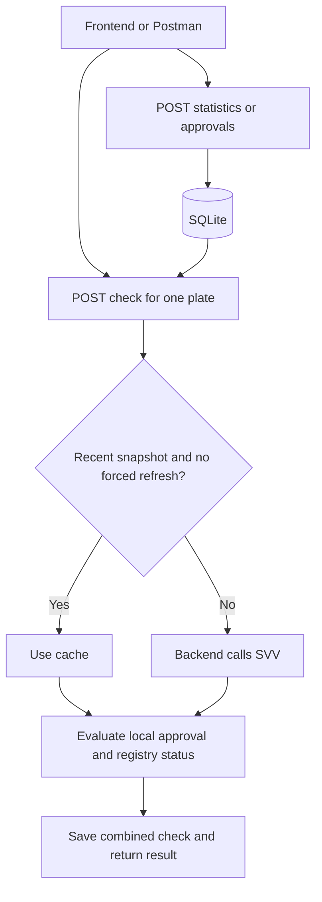
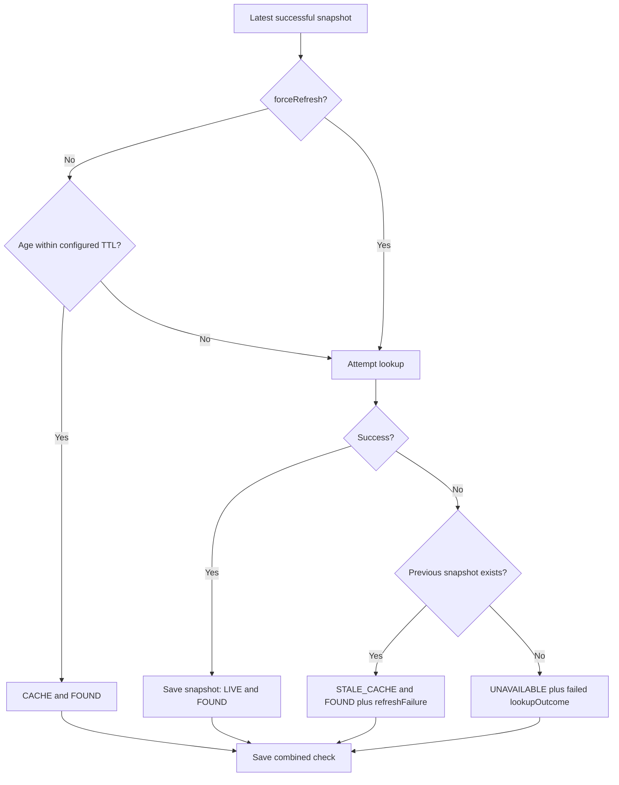
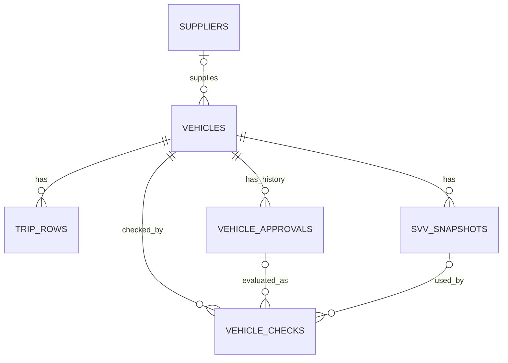

# Vehicle backend guide

This Kotlin/Ktor service accepts JSON containing vehicle statistics and approvals, stores them in SQLite, and checks one registration number against local approval data and Statens vegvesen (SVV).

A statistics row may cover several jobs or days. It is not assumed to be one dated trip. Approval is separate: submitting statistics never approves a vehicle. All examples here are synthetic. Agents must not inspect confidential datasets, real vehicle responses, or logs containing them.

## Request flow

1. Submit usage statistics through `POST /api/trip-rows`.
2. Submit approved vehicles through `POST /api/vehicle-approvals`.
3. Check one plate through `POST /api/vehicle-checks`.
4. The backend reads local approval/statistics, reuses a recent snapshot or calls SVV, then saves and returns a combined result.

There are no import IDs to pair or suppliers to select. The API accepts JSON, not PDF/spreadsheet uploads. Convert source columns into the fields below before submitting.



## Run and configure

Use JDK 21 and the checked-in Gradle wrapper. Docker/Rancher Desktop is optional. An SVV Enkeltoppslag key is required only for live requests.

From `backend/` in PowerShell:

```powershell
Copy-Item .env.example .env
# Edit .env locally; do not overwrite an existing configured file.
.\gradlew.bat test
.\gradlew.bat run
```

Tests do not start a persistent Postman server. Keep the run terminal open; stop with `Ctrl+C`.

| Setting | Default | Where to set | Meaning |
|---|---|---|---|
| `SVV_API_KEY` | Unset | Process environment or `.env` | Private key enabling live SVV requests |
| `SVV_CACHE_TTL_DAYS` | `14` | Process environment or `.env` | Positive whole days a successful snapshot may be reused |
| `VEHICLE_DB_PATH` | `data/vehicles.db` | Process environment | SQLite path; relative paths use the server working directory |
| `HOST` | `127.0.0.1` | Process environment | Listening interface |
| `PORT` | `8080` | Process environment | HTTP port |
| `CORS_ALLOWED_ORIGINS` | `localhost:5173` | Process environment | Comma-separated frontend hosts/ports, e.g. `localhost:5173,127.0.0.1:5173`; omit schemes and paths |

Only the two `SVV_` settings are read from `.env` by the application. Nonblank process values take precedence. Blank process values fall back to `.env` and do not disable a key already there. Invalid, zero, negative, or TTL values too large to represent as a duration fall back to 14. Restart after configuration changes.

Example local `.env`:

```dotenv
SVV_API_KEY=your-private-key-here
SVV_CACHE_TTL_DAYS=14
```

For isolated manual testing:

```powershell
$env:VEHICLE_DB_PATH = "data/manual-test.db"
$env:CORS_ALLOWED_ORIGINS = "localhost:5173"
.\gradlew.bat run
```

These settings apply to that PowerShell session and its child processes. Postman environment variables configure requests, not the backend process.

The key must never be sent to our API, placed in frontend configuration, or committed. `.env` is ignored by Git and excluded from the Docker context. `.env.example` contains no secret.

JWT authentication is available for the auth routes documented below. Vehicle routes are still unauthenticated and have no role/supplier access restrictions. CORS does not provide authorization. The standalone default host and Compose's published backend port are bound to loopback for local development. Local processes can still access these endpoints; authentication and authorization must be implemented before deployment or exposure to other machines.

### Docker

From `backend/`:

```powershell
docker build -t ktor-backend .
docker run --env-file .env -p 127.0.0.1:8080:8080 -v vehicle-backend-data:/app/data ktor-backend
```

The key is supplied at runtime. The named volume preserves SQLite across container replacement. The container listens on `0.0.0.0`; this command publishes only on the host loopback interface.

For the full stack, use the [root README](../README.md#run-the-full-stack-with-docker). Compose reads the root `.env`, requires JWT/seed-password settings, passes optional SVV settings, and mounts persistent vehicle storage. Standalone auth settings must be process environment variables; the application does not load them from `backend/.env`.

## Authentication

Vehicle records use SQLite, but the separate authentication user store is currently in memory. These demo users are seeded at startup:

| Email | Role | Password environment variable |
|---|---|---|
| `advisor.hansen@kommune.no` | `ADMIN` | `SEED_ADMIN_PASSWORD` |
| `supplier@nordvik.no` | `SUPPLIER` | `SEED_SUPPLIER_PASSWORD` |

User IDs are regenerated on restart, so old JWTs stop identifying these users after a backend restart. The seeded supplier identifier is not automatically linked to the vehicle database's supplier table.

| Process setting | Default / meaning |
|---|---|
| `JWT_SECRET` | Insecure development fallback with warning; explicitly set outside local development |
| `JWT_ISSUER` | `tdt4290-backend` |
| `JWT_AUDIENCE` | `tdt4290-frontend` |
| `SEED_ADMIN_PASSWORD` | Insecure development fallback with warning |
| `SEED_SUPPLIER_PASSWORD` | Insecure development fallback with warning |

The following routes are separate from the vehicle API:

| Method and route | Request | Response / behavior |
|---|---|---|
| `POST /api/auth/login` | JSON strings `email`, `password`; optional boolean `rememberMe` (false) | 200 with `token`, `expiresAt`, `user`; empty credentials 400; invalid credentials 401 |
| `GET /api/auth/me` | `Authorization: Bearer <token>` | 200 with current public user; missing/invalid token 401 |
| `POST /api/auth/logout` | Bearer token, no body | 200; client must discard token; token is not invalidated server-side |
| `POST /api/auth/forgot-password` | JSON string `email` | 200 regardless of account existence; currently no email/reset flow is implemented |

Public user fields are `id`, `name`, `email`, `role`, and optional `supplierId`; password hashes are not returned. Tokens expire after one day, or 30 days with `rememberMe: true`. Login and forgot-password share the configured limit of 10 requests/minute per client IP; exceeding it returns 429.

Handled auth credential errors use `{"message":"..."}`, whereas handled vehicle errors use `{"error":"..."}`. Auth bodies use Ktor request decoding; the vehicle-specific validation/error rules below should not be assumed for auth decoding failures.

Postman login example (set a local `adminPassword` variable matching the backend process setting):

```json
{
  "email": "advisor.hansen@kommune.no",
  "password": "{{adminPassword}}",
  "rememberMe": false
}
```

Save the returned token in a local `token` variable. For `/me` and `/logout`, select Postman Authorization → Bearer Token and enter `{{token}}`. Vehicle tests continue to use No Auth. Do not share credentials or tokens with agents.

## Shared request rules

For vehicle routes, send JSON POST bodies with `Content-Type: application/json`. No Authorization header is required. There are no defined query parameters; plates belong in bodies or the revocation path.

- Names are case-sensitive; unknown fields are rejected.
- Required fields cannot be omitted or null. Optional nullable fields may be omitted or null.
- Booleans use unquoted `true`/`false`.
- Statistics amounts and counts are strings, e.g. `"45.5"`, not JSON numbers. Values are preserved without numerical validation or aggregation.
- `additionalFields` is an object of string values, defaulting to an empty object.
- Plates are uppercased; whitespace and hyphens are removed. Synthetic `AB 12345`, `ab12345`, and `AB-12345` identify one vehicle.
- Normalized plates must have 2–7 characters from A–Z/0–9. This is syntax validation, not proof of SVV recognition.
- Batches contain 1–10,000 entries. An invalid entry rejects the batch. Statistics/approval writes are transactional.
- Dates use `yyyy-MM-dd`. Empty strings are invalid dates. Expiry cannot precede start.
- Generated IDs are UUID strings. Timestamps are UTC instants; approval is evaluated using today's date in Europe/Oslo.

Responses may omit optional null/default-valued fields. Consumers should not require every optional property to appear.

## Routes and HTTP statuses

| Method and route | Purpose | Success |
|---|---|---|
| `GET /health` | Liveness response `{"status":"UP"}` | 200 |
| `GET /` | Text `Hello World!` | 200 |
| `POST /api/trip-rows` | Append statistics | 201 |
| `POST /api/vehicle-approvals` | Add/replace approvals | 201 |
| `POST /api/vehicle-approvals/{registrationNumber}/revoke` | Revoke one approval | 200 |
| `POST /api/vehicle-checks` | Create/save a combined check | 201 |
| `GET /api/vehicle-checks/{id}` | Read an original saved check | 200 |

Health does not verify SVV credentials, connectivity, or approval.

Validation failures return 400, normally with `{"error":"..."}`. Missing saved checks or unrevoked approvals return 404. Unhandled errors return 500 with plain text `Internal server error`.

A saved check returns 201 even if SVV fails. An external `ACCESS_DENIED` outcome does not change our response to HTTP 401. Approval replacements also return 201.

## Append statistics

```http
POST /api/trip-rows
Content-Type: application/json

{
  "sourceName": "synthetic-statistics",
  "rows": [
    { "registrationNumber": "AB 12345", "fuel": "Diesel", "tripCount": "3", "totalTripKm": "45.5" },
    { "registrationNumber": "AB12345", "assignmentNumber": "EXAMPLE-2", "tripCount": "7" }
  ]
}
```

`rows` is required. `sourceName` is an optional descriptive label, trimmed on storage; blank labels become null. It is not an import ID or filter used for checks.

Each row requires `registrationNumber`. All other fields are optional:

| Field | Type | Source column / meaning |
|---|---|---|
| `fuel` | String | Drivstoff / Type drivstoff |
| `make` | String | Bilmerke |
| `vehicleType` | String | Biltype |
| `model` | String | Bilmodell |
| `co2Registered` | Boolean | Submitted CO₂-emitting/registered flag; stored without policy interpretation |
| `co2GramsPerKm` | String | CO2g/km |
| `medianCo2` | String | Median CO2; source definition is not established |
| `totalTripKm` | String | Tot km tur |
| `totalKmCo2Registered` | String | Tot km co2 registrert |
| `totalKmCo2NotRegistered` | String | Tot km co2 ikke registrert |
| `kmFuelNotRegistered` | String | Km drivstoff ikke registrert |
| `totalKmFuelRegistered` | String | Tot km drivstoff registrert |
| `tripCount` | String | #turer |
| `assignmentNumber` | String | Oppdrag nr. |
| `averageConsumptionLitresPerKm` | String | Gjennomsnittlig forbruk L/km |
| `kmPerBus` | String | Km per buss |
| `fuelConsumptionLitresPerBus` | String | Drivstofforbruk L per buss |
| `comment` | String | Kommentar |
| `additionalFields` | Object of strings | Extra columns retained without interpretation |

There is no trip date or approval flag. Source-specific meanings are not inferred.

The response contains `createdAt`, `rowCount`, `distinctVehicleCount`, and `rows`. Each stored row contains `id`, `vehicleId`, optional `sourceName`, `createdAt`, and submitted `data`.

The example appends two rows for one vehicle. Repeating it appends two more. No deduplication or summation occurs. Retrieval orders by creation time then UUID, so rows from one submission need not retain input order.

## Add or replace approvals

```http
POST /api/vehicle-approvals
Content-Type: application/json

{
  "sourceName": "synthetic-approvals",
  "approvals": [
    {
      "registrationNumber": "AB12345",
      "fuelTechnology": "Elektrisk/Hydrogen",
      "usedThroughoutPeriod": true,
      "vehicleGroup": "example group"
    }
  ]
}
```

`approvals` is required. Optional `sourceName` has the same label semantics as statistics.

| Approval field | Type | Meaning |
|---|---|---|
| `registrationNumber` | String | Required vehicle identifier |
| `fuelTechnology` | String | Optional submitted fuel technology |
| `usedThroughoutPeriod` | Boolean | Optional sheet answer; does not override dates |
| `startDate` | String/null | Optional ISO date; absent/null means effective immediately |
| `expiryDate` | String/null | Optional ISO date; absent/null means indefinite until revocation |
| `vehicleGroup` | String | Optional category |
| `additionalFields` | Object of strings | Optional extra source data |

There is at most one unrevoked approval per vehicle. A submission adds one if absent, or replaces the existing unrevoked record's data, including an expired/future record.

**Updates are full replacements.** Omitting an existing expiry date deliberately removes it and makes approval indefinite. Other omitted optional fields are cleared too. Omitting `sourceName` clears the label. ID/creation time remain; update time changes.

Omitted vehicles are untouched. Repeated normalized plates in a batch are processed in order; the last entry determines final stored data. `approvalCount` counts entries, not distinct vehicles.

The response contains `updatedAt`, `approvalCount`, and `approvals`. Stored approvals contain `id`, `vehicleId`, optional `sourceName`, creation/update times, optional `revokedAt`, and `data`.

Revoked records are retained. Reapproval creates a new ID. Ordinary edits do not preserve every previous approval version; saved checks retain their original approval data.

### Approval evaluation

Evaluation uses today in Europe/Oslo, not historical dates for the statistics.

| Condition | Status | Local deviation |
|---|---|---|
| No record | `NOT_APPROVED` | `NOT_ON_APPROVED_LIST` |
| Selected record revoked | `REVOKED` | `APPROVAL_REVOKED` |
| Start later than today | `NOT_YET_ACTIVE` | `APPROVAL_NOT_YET_ACTIVE` |
| Expiry earlier than today | `EXPIRED` | `APPROVAL_EXPIRED` |
| Otherwise | `ACTIVE` | None |

Start/expiry are inclusive. Missing expiry means indefinite; do not send `"infinite"`. Fuel technology, category, and period flag are stored but do not generate deviations.

### Revoke manually

```http
POST /api/vehicle-approvals/AB12345/revoke
```

The plate is a path parameter. No body is needed. Returns the approval with revocation/update timestamps. An unrevoked expired/future approval can also be revoked. No unrevoked record, including repeat revocation, returns 404. Statistics, snapshots, and saved checks remain.

## Check one vehicle

```http
POST /api/vehicle-checks
Content-Type: application/json

{ "registrationNumber": "AB12345", "forceRefresh": false }
```

`registrationNumber` is required. Boolean `forceRefresh` defaults to false; true bypasses cache reuse and attempts SVV when configured.

An unknown plate creates a local vehicle with null supplier and no approval, and is still checked against SVV. No prior statistics submission is needed.

Each POST creates a new saved check. Local approval and statistics are reread even if registry data is cached.

| Combined response field | Meaning |
|---|---|
| `id` | Saved check UUID |
| `checkedAt` | Time check began |
| `vehicle` | Local ID, normalized plate, nullable supplier ID, creation time |
| `approvalStatus` | Current local approval evaluation |
| `approval` | Selected stored approval, if any |
| `tripRows` | All statistics rows for this vehicle, or empty list |
| `registry` | Registry data, origin, outcome, and findings |
| `deviations` | Distinct combined local and registry findings |

Statistics are not aggregated or compared with SVV fuel/CO₂ data. A check does not itself prove a vehicle was in operation.

### Registry fields

| Field | Meaning |
|---|---|
| `dataSource` | `LIVE`, `CACHE`, `STALE_CACHE`, or `UNAVAILABLE` |
| `lookupOutcome` | Usable registry data found, or lookup failure |
| `fetchedAt` | Snapshot timestamp, unchanged on reuse |
| `registrationStatus` | Extracted registration code, when available |
| `data` | Complete parsed SVV response in the generic model explained below |
| `usageProhibitionState` | Currently always `UNKNOWN` |
| `deviations` | Registration findings from the snapshot |
| `snapshotId` | Successful snapshot used |
| `refreshFailure` | Failure from an attempted refresh when prior data is returned |

An empty combined deviation list does not prove all checks passed. An approved vehicle can have no deviations while SVV is unavailable. Inspect registry origin/outcome/failure as well.

### Cache and fallback



A snapshot is fresh when elapsed age is nonnegative and no greater than the configured duration, including exactly 14 days by default. Its timestamp is captured when the check starts. Failed lookups are not snapshots and are not cached. No automatic retries or background refreshes occur.

A forced request cannot make an external call without a configured key and does not guarantee fresh data.

**Every failed refresh uses a previous successful snapshot when available.** This includes `NOT_FOUND`, `ACCESS_DENIED`, and `NOT_CONFIGURED`, even if a forced refresh failed while the snapshot was within TTL. There is no maximum fallback age.

Fallback returns `STALE_CACHE`, with `lookupOutcome: FOUND` describing the stored data and `refreshFailure` describing the new failure. Registry deviations come from that earlier observation, not a newly confirmed status. Local approval evaluation remains current.

### External lookup and outcomes

The backend URL-encodes the normalized plate and sends:

```text
GET https://akfell-datautlevering.atlas.vegvesen.no/enkeltoppslag/kjoretoydata?kjennemerke=<plate>
SVV-Authorization: Apikey <private-key>
Accept: application/json
```

Connection timeout: 10 seconds. Request timeout: 20 seconds. Clients call our backend with the plate; they do not receive or supply the SVV key.

These are this implementation's response mappings, not a complete external API specification:

| External result | Outcome |
|---|---|
| 200, valid JSON, exactly one entry in `kjoretoydataListe` | `FOUND` |
| Empty list or 404 | `NOT_FOUND` |
| 401/403 | `ACCESS_DENIED` |
| 422/429 | `QUOTA_EXHAUSTED` |
| 500/502/503/504, I/O error, timeout, interruption | `TEMPORARILY_UNAVAILABLE` |
| Malformed/unexpected JSON, missing list, multiple entries, other status | `INVALID_RESPONSE` |
| Client absent because no key is configured | `NOT_CONFIGURED` |

Raw external failure bodies are not exposed. A successful snapshot can still have an unknown registration code.

| SVV registration code | Deviation |
|---|---|
| `REGISTRERT` | None |
| `AVREGISTRERT` | `DEREGISTERED` |
| `UTFORT` | `EXPORTED` |
| `VRAKET` | `SCRAPPED` |
| `UREGISTRERT` | `UNREGISTERED` |
| Missing/other in a successful snapshot | `UNKNOWN_REGISTRATION_STATUS` |

The extracted original path is `kjoretoydataListe[0].registrering.registreringsstatus.kodeVerdi`. A failed lookup without a snapshot reports its outcome, not a fabricated registration deviation.

This integration cannot establish bruksforbud; `usageProhibitionState: UNKNOWN` does not mean no prohibition exists.

## Read a saved check

```http
GET /api/vehicle-checks/<check-id>
```

Use the POST response's top-level ID, not the plate or vehicle ID. Returns the original saved response, without calling SVV or reevaluating approval. Later approval/statistics changes do not modify it. Unknown IDs return 404.

## Database and JSON storage

Tables are created automatically. Foreign keys are enabled on each connection. IDs/timestamps are text.



| Table | Contents |
|---|---|
| `suppliers` | ID, name, creation time; reserved for later |
| `vehicles` | Unique normalized plate, ID, nullable supplier FK, creation time |
| `trip_rows` | Vehicle FK, label/time, submitted data in `data_json` |
| `vehicle_approvals` | Vehicle FK, label, dates/timestamps, approval data in `data_json` |
| `svv_snapshots` | Vehicle FK, fetch time/source, extracted registration status, complete response model in `data_json` |
| `vehicle_checks` | Vehicle and optional approval/snapshot FKs, check time, whole response in `data_json` |

No API creates suppliers or assigns supplier IDs yet. At most one unrevoked approval exists per vehicle.

### How complete SVV data is stored

The complete payload is stored as JSON text in SQLite `svv_snapshots.data_json`, not as individual SQL columns for every SVV field. Fetch metadata and extracted registration status also have separate columns.

The original response is parsed into our own generic `RegistryValue` model: objects, arrays, strings, numbers, booleans, and nulls. That model is serialized for storage and returned as `registry.data`. It preserves parsed fields/values, but is not the original HTTP response string and has no named Kotlin property for every SVV business field.

Original synthetic JSON:

```json
{ "exampleField": 12 }
```

Stored/returned representation:

```json
{
  "type": "object",
  "fields": {
    "exampleField": { "type": "number", "value": "12" }
  }
}
```

Objects use `fields`, arrays use `items`, primitive values use `value`, and nodes have a `type` discriminator. Numbers are strings to retain their representation. Consumers must account for this wrapper.

Saved checks also contain whole response JSON, including approval, statistics, and SVV model. This supports historical retrieval but duplicates data as checks accumulate. No retention/cleanup policy is implemented.

## Logging

Logback writes INFO logs to the console: timestamp, thread, level, logger, message. No rotating file logs, central logging, or automated log retention is configured.

Application events record counts, approval/check IDs, registry origin, and deviation counts. They do not intentionally log payloads, keys, or complete SVV responses. Ktor also logs HTTP calls; the revocation path can contain a plate. Unhandled exceptions include stack traces and may contain identifiers. Treat console output as potentially confidential and do not share real-data logs with agents.

Saved checks/snapshots are database records, not console logs. They do not identify the user performing a vehicle action because vehicle routes are not connected to authentication.

## Postman walkthrough

Use synthetic local records. Real SVV testing must be performed by an authorized developer without sharing records/responses with agents.

1. Start the backend from `backend/` with `.\gradlew.bat run`.
2. Use the Postman desktop app, or its web app with Desktop Agent.
3. Click **Environments** in the sidebar, create `Local Backend`, and add the values below.
4. Save and select it in the upper-right environment dropdown.

| Variable | Local/current value |
|---|---|
| `baseUrl` | `http://127.0.0.1:8080` |
| `plate` | `AB12345` (synthetic) |
| `checkId` | Empty initially |

If both initial/current values appear, use current values for local requests. Variables belong under **Environments**, not **Params**. `{{baseUrl}}` substitutes the saved address. Postman variables do not set server settings.

Create a collection named `Vehicle Backend`. Save each request there. For POST JSON, select **Body → raw → JSON**, paste the body, then **Send**. Use **No Auth**. Never put the SVV key in Postman.

### Test sequence

1. GET `{{baseUrl}}/health`: expect 200 and `{"status":"UP"}`.
2. POST `{{baseUrl}}/api/trip-rows`: use the statistics example, replacing example plates with `{{plate}}`. Expect 201, two rows, one distinct vehicle.
3. POST `{{baseUrl}}/api/vehicle-approvals`: use the approval example with `{{plate}}`. Expect 201.
4. POST `{{baseUrl}}/api/vehicle-checks` with:

```json
{ "registrationNumber": "{{plate}}", "forceRefresh": false }
```

Expect 201 and `ACTIVE`. Without a key/snapshot, expect `UNAVAILABLE`/`NOT_CONFIGURED`. A synthetic plate is not expected to produce a successful real SVV result.

5. Copy top-level `id` into environment variable `checkId` and save.
6. GET `{{baseUrl}}/api/vehicle-checks/{{checkId}}`: expect 200 and the original result.
7. Repeat POST check: after a successful SVV lookup, expect `CACHE`. Failed uncached lookups do not establish a cache.
8. Set `forceRefresh` to true: expect `LIVE` on success, or the documented failure/fallback.
9. POST `{{baseUrl}}/api/vehicle-approvals/{{plate}}/revoke` with no body: expect 200.
10. Repeat POST check: expect `REVOKED` and `APPROVAL_REVOKED`.
11. Submit approval again: expect a new approval ID and `ACTIVE` on the next check.

Statistics repeats append. Approval repeats replace the unrevoked record. Old saved checks remain unchanged.

### Optional script

On a POST check, open **Scripts → Post-response**, or **Tests** in older versions:

```javascript
pm.test("A check was created", function () {
    pm.response.to.have.status(201);
    const body = pm.response.json();
    pm.expect(body.id).to.be.a("string");
    pm.environment.set("checkId", body.id);
});
```

This stores the ID automatically. See **Test Results** after sending. Passing HTTP status alone does not prove SVV success.

### Troubleshooting

| Symptom | Check |
|---|---|
| `ECONNREFUSED` | Server running, correct port, local agent selected |
| Unresolved `{{baseUrl}}` | Environment saved/selected, name correct |
| Invalid JSON 400 | Raw JSON, field names/types correct, no unsupported fields |
| `NOT_CONFIGURED` | Configure key locally and restart |
| `ACCESS_DENIED` | SVV rejected backend credentials |
| `NOT_FOUND` | Synthetic/unknown plate; separate from local approval |
| `STALE_CACHE` | Inspect `refreshFailure` and `fetchedAt` |
| Saved-check 404 | Correct check ID, same server/database |
| Frontend CORS error | Configure frontend host/port and restart |

## Current boundaries

No endpoints list all vehicles/approvals/checks or paginate statistics. No supplier assignment, statistics deletion, spreadsheet parsing, batch checking, background monitoring, fuel/CO₂ policy comparisons, or automatic cleanup is implemented. These describe current behavior, not promised future features.
