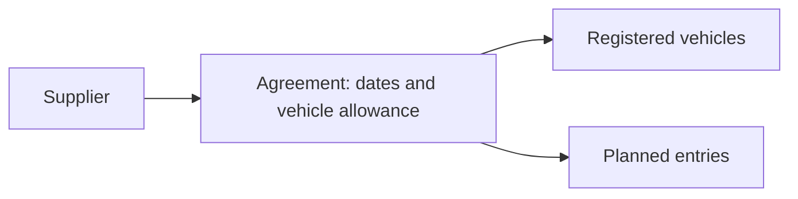

# Frontend

React, TypeScript and Vite application with admin and supplier workspaces. See the [project overview and setup](../README.md) for feature availability, prerequisites, configuration and accounts.

## Certificates

- Upload a supplier certificate as a PDF (up to 8 MB and 25 pages). The backend extracts its type and issue/expiry dates and shows its current status, sorted by urgency. The overview also shows the contract reference; **Details** reveals the source filename and record ID.
- Scanned PDFs require Tesseract OCR configured on the backend; searchable PDFs use native text extraction.
- The original PDF is discarded after processing. Extracted metadata is saved in the SQLite database and survives backend restarts. Confirm parser results against the source before taking action; a missing expiry date is flagged for review.
- Administrators can edit supplier, certificate type, issue/expiry dates, and contract reference, or delete a certificate after confirmation. Editing metadata does not reprocess the PDF; upload the document again if its extracted details need to be refreshed.
- Certificate routes require a real administrator login. They are not served by mock data or mock authentication.

## Supplier onboarding

The supplier dashboard is connected to the onboarding API. It supports saving the sustainability contact, viewing onboarding progress and agreements, downloading a CSV template, previewing backend validation errors, confirming valid imports, and submitting the dossier. CSV uploads are limited by the backend to 4 MiB. The authenticated supplier account must already be linked to an organization with an active agreement before agreement-specific CSV imports can pass validation.

## Development

Configure the root `.env` and start the backend first. Then, from `frontend/`:

```sh
npm ci
npm run dev
```

Open `http://localhost:5173`.

| Command | Purpose |
|---|---|
| `npm run build` | Type-check and build the application into `dist/`. |
| `npm test -- --run` | Run the frontend tests once. |
| `npm run preview` | Serve the built application locally; requires a build first. |

## Data and workflows

The default setup combines demo data (`VITE_USE_MOCKS=true`) with backend sign-in (`VITE_MOCK_AUTH=false`). Vehicles always uses the backend. Setting `VITE_USE_MOCKS=false` prevents Dashboard, Suppliers and Contracts from loading data because their backend endpoints are not implemented.

In Vehicles, the structure is:



Create a supplier, then an agreement, then add vehicles within that agreement. Planned entries reserve spaces before registration numbers are known. Registered entries require a working registry integration. Vehicle details bring together reported statistics, checks and saved evidence; agreement and vehicle-list changes have a separate change history.

Demo supplier notes and follow-up status are stored in the browser. Demo alert changes are held in memory and reset on a page reload. These demo records do not populate the vehicle directory.

## Code navigation

| Directory | Contents |
|---|---|
| [`src/app/`](src/app/) | Routing, layouts and role guards. |
| [`src/pages/`](src/pages/) and [`src/components/`](src/components/) | Role-specific screens and reusable UI. |
| [`src/api/`](src/api/) and [`src/hooks/`](src/hooks/) | Requests, queries and mutations. |
| [`src/mocks/`](src/mocks/) | Demonstration data and mock sign-in. |
| [`src/types/`](src/types/) and [`src/utils/`](src/utils/) | Shared data types and utilities. |

The theme is in [`tailwind.config.ts`](tailwind.config.ts), with [global styles](src/styles/globals.css). [Configuration](../docs/configuration.md) includes frontend-only demo mode and connection troubleshooting.
